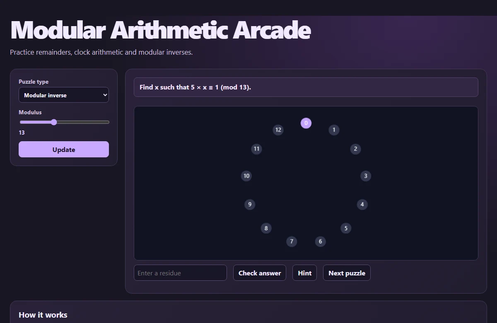

# Modular Arithmetic Arcade

Practice remainders, clock arithmetic and modular inverses.

[Open the web app](https://surfingcoder.com/apps/modular-arithmetic-arcade/)



## Run locally

Serve the repository with Python 3, then open http://127.0.0.1:8000/ in a current browser.

```sh
python -m http.server 8000 --bind 127.0.0.1
```

Start with the provided example. Adjust the controls and select **Update** to recompute. Sliders refresh the result as you move them.

## Method

The least residue lies between zero and m−1. An inverse exists when the gcd of a and m is 1. The hints expose a Euclidean or remainder step.

## Verify

Run `node --test check.mjs` with Node.js 22 or newer. The check runs the app’s mathematical regression cases without a browser.
